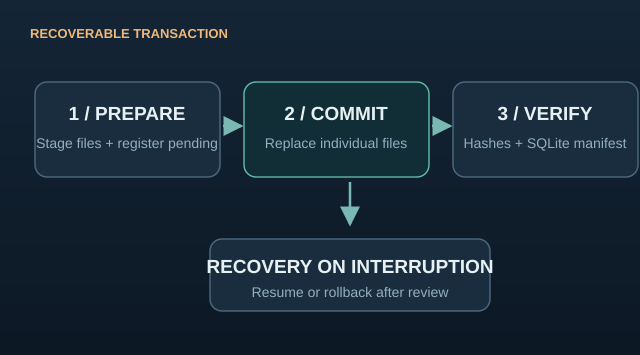

# Code Grinder — User Guide

[Code Grinder / GitHub](https://github.com/musikfed/Code-Grinder) · [Live project showcase / UI concept](https://musikfed.github.io/view_my_prj/projects/Code-Grinder/?lang=en) · v2.2 / Stage 2

A local, recoverable core for turning small-model AI output into controlled project changes. v2.2, Stage 2 complete.

## 1. Install and test

```bash
git clone https://github.com/musikfed/Code-Grinder.git
cd Code-Grinder
uv sync
uv run pytest -q
uv run ruff check .
```

## 2. Create a project

```bash
uv run python main.py init --name my_project --language python --architecture Minimal --directory .
# Available stacks: python, node, go, rust, java, cpp, csharp, noop
# The interactive wizard: uv run python main.py init
```

## 3. Model response: TARGET / MODE

````text
TARGET: src/hello.py
MODE: CREATE
```python
print("Hello, Code Grinder!")
```

TARGET: src/hello.py
MODE: PATCH
```text
<<<<<<< SEARCH
print("Hello, Code Grinder!")
=======
print("Hello, version 2.2!")
>>>>>>> REPLACE
```
````

## 4. Change modes

- CREATE — create only if missing
- OVERWRITE — replace after checking the existing version
- APPEND — append and validate the entire result
- PATCH — replace exactly one SEARCH/REPLACE match

PASS — validated; FAIL — source invalid; SKIPPED — checker unavailable; ERROR — checker malfunction.

## 5. Use the core library

Prepare a change and inspect its Diff; never write without explicit approval:

```python
from pathlib import Path
from grinder.database import Database
from grinder.file_ops import FileManager
from grinder.parser import parse_response

root = Path("my_project").resolve()
db = Database(root / ".grinder" / "grinder.db")
manager = FileManager(root, db)
answer = (
    "TARGET: src/new.py\n"
    "MODE: CREATE\n"
    "```python\nprint('Hello!')\n```\n"
)
preview = manager.prepare(parse_response(answer))
for item in preview:
    print(item.diff, item.validation.status)

# English comment: a new function is created only after review and approval.
# After explicit approval only:
# manager.commit(preview, approved=True, allow_skipped=False)
```

## 6. Recovery and safety

SHA-256 detects manual edits. Inspect interrupted transactions before choosing recovery; finishing or rolling back requires an explicit decision. Multi-file changes are recoverable but not atomically visible as a single filesystem transaction. Windows path checks are not a complete hostile-concurrency boundary.

If packages are already installed, run `python -m pytest` without network access. `uv run --offline pytest` requires all dependencies to be present in the uv cache.

## 7. Web UI and screenshots

Images below are UI concepts, NOT screenshots of a running FastAPI service. The serve command, process API, browser approvals and Project Map are not implemented yet. The interactive mockup never writes files.


### Diagrams / Схемы





