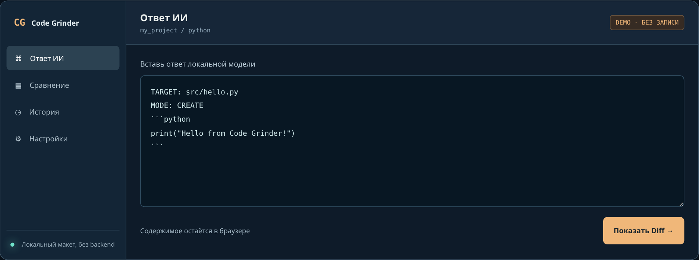

# Code Grinder — Guide utilisateur

[Code Grinder / GitHub](https://github.com/musikfed/Code-Grinder) · [Live project showcase / UI concept](https://musikfed.github.io/view_my_prj/projects/Code-Grinder/?lang=fr) · v2.2 / Stage 2

Un noyau local et récupérable pour transformer les réponses de petits modèles IA en modifications contrôlées. v2.2, étape 2 terminée.

## 1. Installation et tests

```bash
git clone https://github.com/musikfed/Code-Grinder.git
cd Code-Grinder
uv sync
uv run pytest -q
uv run ruff check .
```

## 2. Créer un projet

```bash
uv run python main.py init --name my_project --language python --architecture Minimal --directory .
# Available stacks: python, node, go, rust, java, cpp, csharp, noop
# The interactive wizard: uv run python main.py init
```

## 3. Réponse du modèle : TARGET / MODE

````text
TARGET: src/hello.py
MODE: CREATE
```python
print("Hello, Code Grinder!")
```

TARGET: src/hello.py
MODE: PATCH
```text
<<<<<<< SEARCH
print("Hello, Code Grinder!")
=======
print("Hello, version 2.2!")
>>>>>>> REPLACE
```
````

## 4. Modes de modification

- CREATE — créer seulement si le fichier est absent
- OVERWRITE — remplacer après contrôle de la version existante
- APPEND — ajouter et valider le fichier complet
- PATCH — remplacer une unique correspondance SEARCH/REPLACE

PASS — validé ; FAIL — code invalide ; SKIPPED — non vérifié ; ERROR — erreur du vérificateur.

## 5. Utiliser la bibliothèque

Préparer le changement et examiner le Diff ; ne jamais écrire sans accord explicite:

```python
from pathlib import Path
from grinder.database import Database
from grinder.file_ops import FileManager
from grinder.parser import parse_response

root = Path("my_project").resolve()
db = Database(root / ".grinder" / "grinder.db")
manager = FileManager(root, db)
answer = (
    "TARGET: src/new.py\n"
    "MODE: CREATE\n"
    "```python\nprint('Hello!')\n```\n"
)
preview = manager.prepare(parse_response(answer))
for item in preview:
    print(item.diff, item.validation.status)

# Commentaire en français : écrire seulement après examen et approbation des changements.
# After explicit approval only:
# manager.commit(preview, approved=True, allow_skipped=False)
```

## 6. Récupération et sécurité

SHA-256 détecte les modifications manuelles. Examinez toute transaction interrompue avant de choisir entre reprise et annulation. Le lot multi-fichiers est récupérable, mais pas atomique pour l’ensemble des fichiers. Sous Windows, la protection des chemins ne garantit pas la sécurité face à un adversaire concurrent.

Si les paquets sont déjà installés, utilisez `python -m pytest` hors ligne. `uv run --offline pytest` exige que les dépendances soient présentes dans le cache uv.

## 7. Interface web et visuels

Les images ci-dessous sont des maquettes, PAS des captures d’un FastAPI en service. La commande serve, l’API de traitement, les validations web et Project Map ne sont pas encore implémentés. La démo n’écrit aucun fichier.




### Diagrams / Схемы


