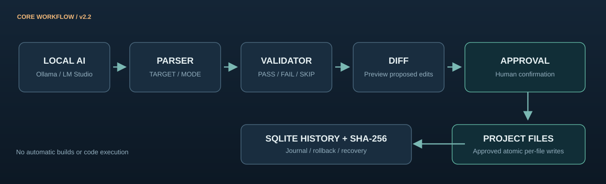

# Code Grinder — ユーザーガイド

[Code Grinder / GitHub](https://github.com/musikfed/Code-Grinder) · [Live project showcase / UI concept](https://musikfed.github.io/view_my_prj/projects/Code-Grinder/?lang=ja) · v2.2 / Stage 2

小規模なローカル AI の出力を、安全で復旧可能なプロジェクト変更に変換します。v2.2、ステージ2完了。

## 1. インストールとテスト

```bash
git clone https://github.com/musikfed/Code-Grinder.git
cd Code-Grinder
uv sync
uv run pytest -q
uv run ruff check .
```

## 2. プロジェクト作成

```bash
uv run python main.py init --name my_project --language python --architecture Minimal --directory .
# Available stacks: python, node, go, rust, java, cpp, csharp, noop
# The interactive wizard: uv run python main.py init
```

## 3. モデルの応答: TARGET / MODE

````text
TARGET: src/hello.py
MODE: CREATE
```python
print("Hello, Code Grinder!")
```

TARGET: src/hello.py
MODE: PATCH
```text
<<<<<<< SEARCH
print("Hello, Code Grinder!")
=======
print("Hello, version 2.2!")
>>>>>>> REPLACE
```
````

## 4. 変更モード

- CREATE — ファイルが存在しないときのみ作成
- OVERWRITE — 既存版を確認して上書き
- APPEND — 追記後に全体を検証
- PATCH — SEARCH/REPLACE が一度だけ一致した場合に置換

PASS — 検証済み; FAIL — コードのエラー; SKIPPED — 未検証; ERROR — 検証ツールの障害。

## 5. コアライブラリの使用

変更を準備して Diff を確認し、明示的な承認なしでは書き込まない:

```python
from pathlib import Path
from grinder.database import Database
from grinder.file_ops import FileManager
from grinder.parser import parse_response

root = Path("my_project").resolve()
db = Database(root / ".grinder" / "grinder.db")
manager = FileManager(root, db)
answer = (
    "TARGET: src/new.py\n"
    "MODE: CREATE\n"
    "```python\nprint('Hello!')\n```\n"
)
preview = manager.prepare(parse_response(answer))
for item in preview:
    print(item.diff, item.validation.status)

# 日本語コメント: 内容を確認し、承認した場合にだけ変更を書き込みます。
# After explicit approval only:
# manager.commit(preview, approved=True, allow_skipped=False)
```

## 6. 復旧と安全性

SHA-256 で手動変更を検出します。中断トランザクションを確認し、再開またはロールバックを明示的に選択してください。複数ファイルは復旧可能ですが一括の原子的更新ではありません。Windows のパス保護は悪意ある競合操作を完全には防ぎません。

依存関係がインストール済みなら `python -m pytest` をオフラインで実行可能です。`uv run --offline pytest` には uv の完全なキャッシュが必要です。

## 7. Web UI とスクリーンショット

以下の画像は UI のデザイン案で、稼働中の FastAPI のキャプチャではありません。serve、処理 API、ブラウザ承認、Project Map は未実装です。デモはファイルを保存しません。


### Diagrams / Схемы




