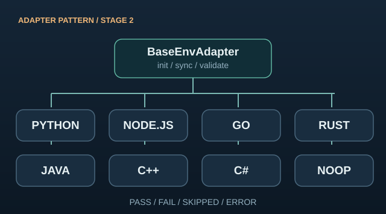

# Code Grinder — 사용자 안내서

[Code Grinder / GitHub](https://github.com/musikfed/Code-Grinder) · [Live project showcase / UI concept](https://musikfed.github.io/view_my_prj/projects/Code-Grinder/?lang=ko) · v2.2 / Stage 2

소규모 로컬 AI 모델의 출력을 안전하게 프로젝트 변경으로 연결하는 복구 가능한 도구입니다. v2.2, 2단계 완료.

## 1. 설치 및 테스트

```bash
git clone https://github.com/musikfed/Code-Grinder.git
cd Code-Grinder
uv sync
uv run pytest -q
uv run ruff check .
```

## 2. 프로젝트 생성

```bash
uv run python main.py init --name my_project --language python --architecture Minimal --directory .
# Available stacks: python, node, go, rust, java, cpp, csharp, noop
# The interactive wizard: uv run python main.py init
```

## 3. 모델 응답: TARGET / MODE

````text
TARGET: src/hello.py
MODE: CREATE
```python
print("Hello, Code Grinder!")
```

TARGET: src/hello.py
MODE: PATCH
```text
<<<<<<< SEARCH
print("Hello, Code Grinder!")
=======
print("Hello, version 2.2!")
>>>>>>> REPLACE
```
````

## 4. 변경 모드

- CREATE — 파일이 없을 때만 생성
- OVERWRITE — 기존 버전을 확인한 후 교체
- APPEND — 추가 후 전체 결과를 검증
- PATCH — 일치하는 SEARCH/REPLACE 블록이 정확히 하나일 때만 교체

PASS — 검증됨; FAIL — 코드 오류; SKIPPED — 검증 불가; ERROR — 검증 도구 오류.

## 5. 코어 라이브러리 사용

변경을 준비하고 Diff를 확인합니다. 명시적 승인 없이는 기록하지 않습니다:

```python
from pathlib import Path
from grinder.database import Database
from grinder.file_ops import FileManager
from grinder.parser import parse_response

root = Path("my_project").resolve()
db = Database(root / ".grinder" / "grinder.db")
manager = FileManager(root, db)
answer = (
    "TARGET: src/new.py\n"
    "MODE: CREATE\n"
    "```python\nprint('Hello!')\n```\n"
)
preview = manager.prepare(parse_response(answer))
for item in preview:
    print(item.diff, item.validation.status)

# 한국어 주석: 변경 사항은 검토와 승인 후에만 파일에 기록됩니다.
# After explicit approval only:
# manager.commit(preview, approved=True, allow_skipped=False)
```

## 6. 복구와 보안

SHA-256으로 수동 변경을 감지합니다. 중단된 트랜잭션은 검사 후 복구 또는 완료를 명시적으로 결정해야 합니다. 여러 파일 변경은 복구 가능하지만 전체 파일 집합이 원자적으로 바뀌지는 않습니다. Windows 경로 보호는 악의적인 동시 변경에 대한 완전한 보장은 아닙니다.

패키지가 설치된 경우 `python -m pytest`를 오프라인으로 실행할 수 있습니다. `uv run --offline pytest`는 uv 캐시에 모든 의존성이 있어야 합니다.

## 7. 웹 UI 및 이미지

아래 이미지는 실제 FastAPI의 스크린샷이 아닌 UI 시안입니다. serve 명령, 처리 API, 브라우저 승인 및 Project Map은 아직 구현되지 않았습니다. 데모는 파일을 기록하지 않습니다.


### Diagrams / Схемы



