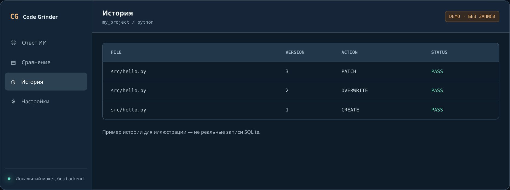

# Code Grinder — руководство пользователя

[Code Grinder / GitHub](https://github.com/musikfed/Code-Grinder) · [Live project showcase / UI concept](https://musikfed.github.io/view_my_prj/projects/Code-Grinder/?lang=ru) · v2.2 / Stage 2

Локальное безопасное ядро для превращения ответов небольших ИИ-моделей в изменения проекта. Версия 2.2, завершён Этап 2.

## 1. Установка и тесты

```bash
git clone https://github.com/musikfed/Code-Grinder.git
cd Code-Grinder
uv sync
uv run pytest -q
uv run ruff check .
```

## 2. Создание проекта

```bash
uv run python main.py init --name my_project --language python --architecture Minimal --directory .
# Available stacks: python, node, go, rust, java, cpp, csharp, noop
# The interactive wizard: uv run python main.py init
```

## 3. Ответ модели: TARGET / MODE

````text
TARGET: src/hello.py
MODE: CREATE
```python
print("Hello, Code Grinder!")
```

TARGET: src/hello.py
MODE: PATCH
```text
<<<<<<< SEARCH
print("Hello, Code Grinder!")
=======
print("Hello, version 2.2!")
>>>>>>> REPLACE
```
````

## 4. Режимы

- CREATE — создать только отсутствующий файл
- OVERWRITE — заменить после проверки существующей версии
- APPEND — добавить текст и проверить весь итоговый файл
- PATCH — заменить ровно одно совпадение SEARCH/REPLACE

PASS — проверено; FAIL — ошибка; SKIPPED — проверка не выполнялась; ERROR — ошибка проверяющего инструмента.

## 5. Использование ядра программно

Подготовить изменение и показать Diff, но не записывать без подтверждения:

```python
from pathlib import Path
from grinder.database import Database
from grinder.file_ops import FileManager
from grinder.parser import parse_response

root = Path("my_project").resolve()
db = Database(root / ".grinder" / "grinder.db")
manager = FileManager(root, db)
answer = (
    "TARGET: src/new.py\n"
    "MODE: CREATE\n"
    "```python\nprint('Hello!')\n```\n"
)
preview = manager.prepare(parse_response(answer))
for item in preview:
    print(item.diff, item.validation.status)

# Комментарий на русском: новая функция создаётся только после проверки и одобрения.
# After explicit approval only:
# manager.commit(preview, approved=True, allow_skipped=False)
```

## 6. Восстановление и защита

SHA-256 обнаруживает ручные изменения файлов. Незавершённые операции нужно проверить до восстановления; завершение или откат требуют явного решения. Запись нескольких файлов восстанавливаема, но не атомарна для всего набора. На Windows защита от злонамеренной конкурентной подмены путей не абсолютна.

Если пакеты уже установлены, запускать тесты без сети можно через `python -m pytest`. `uv run --offline pytest` работает только с заполненным кэшем uv.

## 7. Веб-панель и изображения

Кадры ниже — дизайнерский концепт интерфейса, НЕ скриншоты работающего FastAPI. Команда serve, API обработки, веб-подтверждение и Project Map ещё не реализованы. Интерактивный макет не сохраняет файлы.





### Diagrams / Схемы


