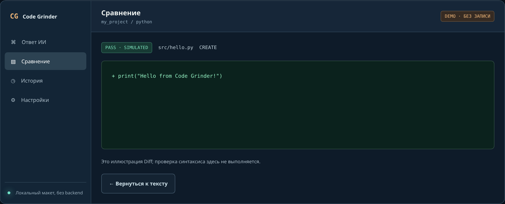
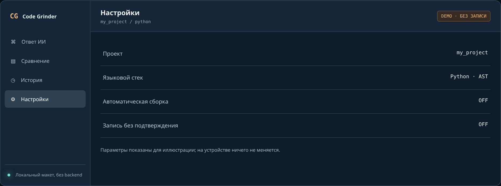

# Code Grinder — 使用指南

[Code Grinder / GitHub](https://github.com/musikfed/Code-Grinder) · [Live project showcase / UI concept](https://musikfed.github.io/view_my_prj/projects/Code-Grinder/?lang=zh) · v2.2 / Stage 2

将小型本地 AI 模型输出转为可控项目变更的可恢复工具。v2.2，已完成第二阶段。

## 1. 安装与测试

```bash
git clone https://github.com/musikfed/Code-Grinder.git
cd Code-Grinder
uv sync
uv run pytest -q
uv run ruff check .
```

## 2. 创建项目

```bash
uv run python main.py init --name my_project --language python --architecture Minimal --directory .
# Available stacks: python, node, go, rust, java, cpp, csharp, noop
# The interactive wizard: uv run python main.py init
```

## 3. 模型回复：TARGET / MODE

````text
TARGET: src/hello.py
MODE: CREATE
```python
print("Hello, Code Grinder!")
```

TARGET: src/hello.py
MODE: PATCH
```text
<<<<<<< SEARCH
print("Hello, Code Grinder!")
=======
print("Hello, version 2.2!")
>>>>>>> REPLACE
```
````

## 4. 修改模式

- CREATE — 仅当文件不存在时创建
- OVERWRITE — 检查旧版本后覆盖
- APPEND — 追加并验证整个结果
- PATCH — 仅替换唯一匹配的 SEARCH/REPLACE 文本

PASS — 检查通过；FAIL — 代码无效；SKIPPED — 未执行检查；ERROR — 检查工具出错。

## 5. 调用核心库

先准备修改并查看 Diff；未经明确批准不得写入:

```python
from pathlib import Path
from grinder.database import Database
from grinder.file_ops import FileManager
from grinder.parser import parse_response

root = Path("my_project").resolve()
db = Database(root / ".grinder" / "grinder.db")
manager = FileManager(root, db)
answer = (
    "TARGET: src/new.py\n"
    "MODE: CREATE\n"
    "```python\nprint('Hello!')\n```\n"
)
preview = manager.prepare(parse_response(answer))
for item in preview:
    print(item.diff, item.validation.status)

# 中文注释：只有在检查并明确确认后才保存修改。
# After explicit approval only:
# manager.commit(preview, approved=True, allow_skipped=False)
```

## 6. 恢复与安全

通过 SHA-256 检测手工修改。中断的事务必须先检查，再决定继续或回滚。多文件修改可以恢复，但并不是整个文件集合的原子事务。Windows 路径防护不能完全防御恶意的并发替换。

已安装依赖时可离线运行 `python -m pytest`。`uv run --offline pytest` 要求 uv 缓存完整。

## 7. 网页界面与截图

以下图片是界面设计图，不是运行中的 FastAPI 截图。serve 命令、处理 API、网页确认和 Project Map 尚未实现。交互原型不会写文件。







### Diagrams / Схемы


